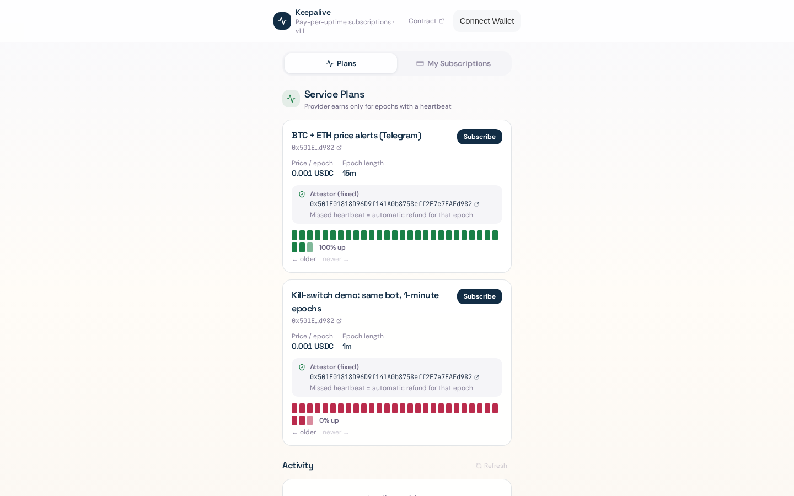

# Keepalive

USDC subscriptions that refund every epoch the service misses.



A provider sells a service by the epoch (say, 15 minutes). Subscribers prepay a number of future epochs into escrow. Each epoch, the provider's heartbeat signer calls `heartbeat(planId)`. After an epoch ends, anyone can settle it: epochs with a heartbeat pay the provider, epochs without one go back to the subscriber. Cancel refunds every epoch that hasn't started yet. Payouts are pull-based (`withdraw` or `settleAndWithdraw`).

No support tickets, no refund requests. A missed heartbeat is the refund.

Built end to end with [Arc Studio](https://studio.arc.io) (contract, tests, audit, app) and running on Arc mainnet with native USDC.

## Live

| | |
|---|---|
| App | https://itsolaph.github.io/keepalive/ |
| Contract (v1.1, mainnet) | [`0xe8F3923191b06c351b2eAdc131AC8BCA81b17DB3`](https://explorer.arc.io/address/0xe8F3923191b06c351b2eAdc131AC8BCA81b17DB3), source verified on Sourcify |
| Deploy tx | [`0xd15783ab…69ca34`](https://explorer.arc.io/tx/0xd15783abb50a9a5c72029031d42f0ca8da9caf4057ff40834174b8a28e69ca34) |
| Arc Studio project | https://studio.arc.io/app/fff2d91c-f912-4cdf-94be-1ae035989bef |

Plans on mainnet:

- **#1 BTC + ETH price alerts (Telegram)**: 0.001 USDC per 15-minute epoch. The bot heartbeats only while its price feed and Telegram both respond.
- **#2 Kill-switch demo**: same bot, 1-minute epochs. Switched on for demos so you can watch a missed heartbeat turn into a refund within a couple of minutes.

## How it works

```
createPlan(price, epochSeconds, signer, name)    provider; signer is fixed for the life of the plan
subscribe(planId, epochs)  payable               subscriber prepays price * epochs, starts next epoch
heartbeat(planId)                                signer marks the current epoch alive (idempotent)
settle(subId)                                    anyone; settles up to 256 ended epochs
cancel(subId)                                    subscriber; refunds epochs that haven't started
settleAndWithdraw(subIds[])                      settle up to 20 subs, then pay out your credit
subscriptionState(subId)                         escrowed / pending to provider / pending to you
```

Every loop is bounded (settle and cancel 256 epochs per call, views 512), the attestor can't be swapped after people subscribe, and the contract always holds exactly the sum of credits plus unsettled escrow (checked by an invariant test).

## Trust model, honestly

The heartbeat is attested by a signer the provider chooses. A dishonest provider could heartbeat while the service is down. What v1.1 guarantees is narrower: the attestor is fixed and public before you pay, a provider that stops attesting gets nothing for those epochs, and refunds need nobody's permission.

The obvious next step is a signer the provider doesn't control: an independent watcher, a k-of-n set of monitors, or another service that pays for the data and therefore has a reason to report when it stops arriving. The contract doesn't need to change for that; the plan just names a different signer.

## Built with Arc Studio

Three Studio turns, all in the project linked above:

1. Contract + 49 Foundry tests + audit + Slither + React app, deployed to Arc testnet.
2. App switched to Arc mainnet (chain 5042), static build for hosting.
3. v1.1 after an outside review: bounded cancel, fixed attestor, idempotent heartbeat, `settleAndWithdraw`, `subscriptionState`, "Claim all", per-epoch tooltips, activity feed. 61 tests, audit clean.

Studio deploys to testnet only, so the identical source and `foundry.toml` were deployed to mainnet with `forge create` and verified on Sourcify.

## Run it

```bash
npm install --legacy-peer-deps
forge test                 # 60 tests (61 with arc-forge --network arc)
npm run dev
```

Network and address live in `src/keepalive-config.ts`.

The heartbeat bot behind plans #1 and #2 is in [`service/keepalive_bot.py`](service/keepalive_bot.py). It's a single Python file with no dependencies beyond `cast` from Foundry.

## Credits

- [forge-std](https://github.com/foundry-rs/forge-std) (MIT / Apache-2.0)
- Prices from the public Coinbase spot price API.

MIT licensed.
